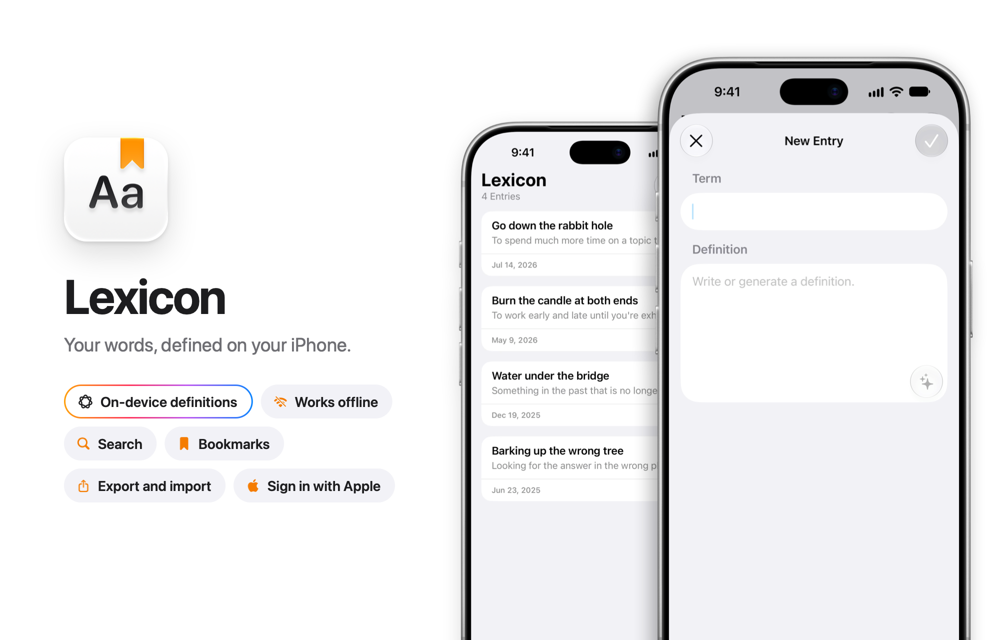

# Lexicon

Vocabulary app in SwiftUI, TCA, Firestore, and Foundation Models.

<picture>
  <source media="(prefers-color-scheme: dark)" srcset=".github/images/hero-dark.png">
  
</picture>

## Core technologies

<table>
  <tr><td><b>Platform</b></td><td>iOS 27</td></tr>
  <tr><td><b>Language</b></td><td>Swift 6</td></tr>
  <tr><td><b>Interface</b></td><td>SwiftUI</td></tr>
  <tr><td><b>Architecture</b></td><td><a href="https://github.com/pointfreeco/swift-composable-architecture">The Composable Architecture</a></td></tr>
  <tr><td><b>Intelligence</b></td><td><a href="https://developer.apple.com/documentation/foundationmodels">Foundation Models</a></td></tr>
  <tr><td><b>Backend</b></td><td>Firebase</td></tr>
  <tr><td><b>Database</b></td><td>Cloud Firestore</td></tr>
  <tr><td><b>Authentication</b></td><td>Sign in with Apple</td></tr>
</table>

## Quality gates

- **Tests:** 220 [Swift Testing](https://github.com/swiftlang/swift-testing) tests cover every reducer, and none touch the network.
- **CI:** GitHub Actions lints and runs the full suite on every pull request that is ready for review.
- **Accessibility:** Every control has a VoiceOver label, and each entry card reads as one element.
- **Localization:** Every string the app shows is ready for translation.

## Engineering decisions

**Definitions.** On request, the on-device Apple Intelligence model writes a one-sentence definition in simple words for English learners. Online, it reads the Wiktionary senses first, and an unknown term gets a note.

**Live sync.** The entry list has one source of truth: a live Firestore listener backed by its local cache, so local changes appear at once, even offline, and sync to every other device.

**Export and import.** Settings exports the entries to a versioned JSON file and imports it back. Each imported entry gets a new ID, so an import never overwrites an entry, and duplicates are skipped.

**One reducer tree.** App state lives in a single tree of reducers instead of scattering across views. Navigation is part of that state, so the whole navigation graph can be inspected and tested from one place.

**No view touches Firebase.** Every effect crosses a client with live, preview, and test implementations, so previews render with no network and a test fails on any effect it doesn't override.

**Apple Account checks.** The app checks the Apple Account credential on launch and each time it becomes active, and it listens for revocations. Only a revoked credential signs the user out.

**Account deletion.** Deleting an account reauthenticates with Apple, deletes the Firestore data, revokes the token, then deletes the account. It times out after 60 seconds, and a failure after the revoke signs out.
